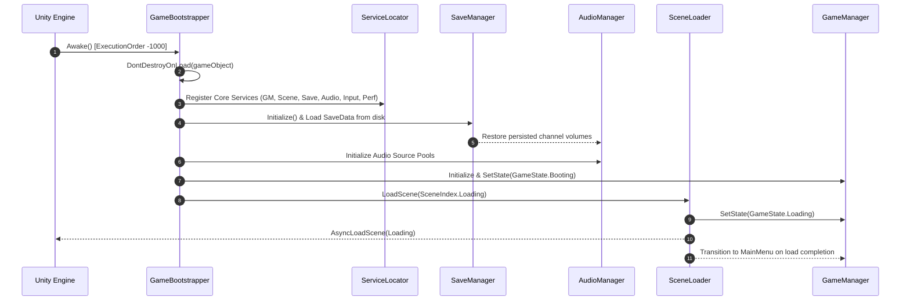

# Indian Bike Life — Core Game Architecture Documentation

## 1. Architectural Overview

**Indian Bike Life** employs a modular, service-oriented architecture designed to avoid the architectural anti-patterns common in mobile game development:
1. **No Monolithic Singletons**: Systems do not expose static instance singletons that tightly bind components together. Instead, services register their interfaces with a centralized, decoupled `ServiceLocator`.
2. **Dual-Layer Event Architecture**:
   - High-throughput systems communicate via the strongly typed C# `EventBus`.
   - Designers and UI prefabs communicate via ScriptableObject `GameEvent` channels.
3. **Decoupled Input State**: Motorcycle physics and vehicle control scripts do not poll hardware APIs directly; they consume an immutable `MotorcycleInputState` struct supplied by `IInputService`.
4. **Resilient Persistence**: The save system features atomic file writes (`.tmp` write before replace), corrupted file backups (`.bak`), checksum hashing, schema versioning, and zero-plaintext storage of sensitive data.
5. **Mobile-First Rendering**: Built exclusively on URP with scalable presets targeting 30 FPS for budget Android hardware and 60 FPS for mid-to-high performance devices.

---

## 2. System Responsibilities

### A. Bootstrap System (`GameBootstrapper`)
- **Location**: `Assets/Game/Core/Bootstrapping/GameBootstrapper.cs`
- **Execution Order**: `-1000` (runs prior to all scene scripts).
- **Responsibility**: Guarantees a persistent root GameObject (`DontDestroyOnLoad`), cleans duplicate bootstrap instances, registers core services, applies runtime settings (e.g., `SleepTimeout.NeverSleep`), and routes to the initial loading scene.

### B. Service Locator (`ServiceLocator`)
- **Location**: `Assets/Game/Core/Services/ServiceLocator.cs`
- **Responsibility**: Provides thread-safe service lookup (`Register<T>`, `Get<T>`, `TryGet<T>`, `Unregister<T>`, `Reset`). Allows unit tests and mock services to be substituted seamlessly without modifying caller scripts.

### C. Game Manager (`GameManager`)
- **Location**: `Assets/Game/Managers/GameManager.cs`
- **Responsibility**: Coordinates application lifecycle (`GameState`: `Booting`, `Loading`, `MainMenu`, `InShowroom`, `Gameplay`, `Paused`, `GameOver`, `ShuttingDown`). Manages `Time.timeScale` and auto-pauses when mobile focus is interrupted.

### D. Scene Loader (`SceneLoader`)
- **Location**: `Assets/Game/Managers/SceneLoader.cs`
- **Responsibility**: Provides asynchronous scene loading with progress smoothing, artificial minimum duration (to prevent flickering loading screens), and event broadcasting. Implements additive scene loading and unloading for future Indian open-world streaming.

### E. Event Bus (`EventBus`)
- **Location**: `Assets/Game/Events/Core/EventBus.cs`
- **Responsibility**: Fast, type-safe publish/subscribe messaging for domain events (`GameStateChangedEvent`, `SceneLoadProgressEvent`, `SaveCompletedEvent`, `AudioVolumeChangedEvent`). Isolates handler exceptions to prevent cascading failures.

### F. Save System (`SaveManager`)
- **Location**: `Assets/Game/Managers/SaveManager.cs`
- **Responsibility**: Serializes versioned `SaveData` (settings + player profile). Handles automatic recovery from corrupted saves and manages migrations across schema versions.

### G. Audio Manager (`AudioManager`)
- **Location**: `Assets/Game/Managers/AudioManager.cs`
- **Responsibility**: Manages independent audio channels (`Master`, `Music`, `SFX`, `Vehicle`, `Ambient`, `UI`). Provides music crossfades, a pooled 2D/3D SFX source system, and state synchronization with `SaveManager`.

### H. Input Manager (`InputManager`)
- **Location**: `Assets/Game/Managers/InputManager.cs`
- **Responsibility**: Consolidates input across on-screen touch controls, keyboard fallback (for Editor development), and future gamepads/accelerometers into a unified `MotorcycleInputState`.

### I. Performance Diagnostics (`PerformanceManager`)
- **Location**: `Assets/Game/Managers/PerformanceManager.cs`
- **Responsibility**: Tracks rolling FPS, frame time (ms), and allocated managed memory (MB) without per-frame allocations. Provides an on-screen HUD toggleable via hotkey or multi-touch.

---

## 3. Initialization Sequence



---

## 4. Scene Management & Loading Pipeline

The loading pipeline is engineered to ensure seamless user experience on Android:
1. `SceneLoader.LoadScene(targetScene)` initiates an asynchronous operation.
2. `operation.allowSceneActivation` is held at `false` while progress is tracked.
3. Raw progress (`0.0` to `0.9`) is mapped to normalized progress (`0.0` to `1.0`) and smoothed with `Mathf.MoveTowards`.
4. `SceneLoadProgressEvent` is broadcast to update loading UI bars and tips.
5. Once raw progress reaches `0.9` and the configurable minimum display duration (default 1.0s) has elapsed, `allowSceneActivation` is set to `true`.
6. `SceneLoadCompletedEvent` is dispatched when the destination scene is active.

---

## 5. Event Bus Communication Matrix

| Event Type | Dispatched By | Consumed By | Description |
| :--- | :--- | :--- | :--- |
| `GameStateChangedEvent` | `GameManager` | UI, Audio, Gameplay | Broadcasts lifecycle transitions. |
| `GamePauseToggledEvent` | `GameManager` | UI, Audio, Physics | Signals simulation pause / unpause. |
| `SceneLoadStartedEvent` | `SceneLoader` | UI, Analytics | Signals start of scene transition. |
| `SceneLoadProgressEvent` | `SceneLoader` | `LoadingScreenUI` | Transmits normalized loading progress. |
| `SceneLoadCompletedEvent`| `SceneLoader` | `GameManager`, UI | Signals destination scene is ready. |
| `SaveCompletedEvent` | `SaveManager` | UI, Analytics | Notifies successful disk write. |
| `AudioVolumeChangedEvent`| `AudioManager` | UI Sliders, Mixer | Signals channel volume modification. |
| `InputDeviceChangedEvent`| `InputManager` | UI, Controls | Signals change in active input hardware. |

---

## 6. Save System & Schema Versioning

### Save File Location
- **Android**: `/storage/emulated/0/Android/data/com.indianbikelife.game/files/indian_bike_save.json` (via `Application.persistentDataPath`).
- **Editor / Desktop**: Persistent data folder of current OS.

### Data Layout
```json
{
  "schemaVersion": 1,
  "saveTimestampUtc": "2026-11-12T05:30:00.000Z",
  "settings": {
    "masterVolume": 0.85,
    "musicVolume": 0.75,
    "sfxVolume": 0.85,
    "vehicleVolume": 0.90,
    "ambientVolume": 0.70,
    "uiVolume": 0.80,
    "graphicsQualityLevel": 1,
    "targetFrameRate": 60,
    "controlType": 0,
    "steeringSensitivity": 1.0,
    "invertSteering": false,
    "hapticFeedbackEnabled": true
  },
  "playerProfile": {
    "playerId": "a3f1...",
    "playerName": "Indian Rider",
    "playerLevel": 1,
    "playerCoins": 1000,
    "unlockedMotorcycleIds": ["bike_classic_350"],
    "selectedMotorcycleId": "bike_classic_350",
    "characterGender": "Male",
    "totalDistanceDrivenKm": 0.0,
    "completedMissionIds": []
  },
  "checksum": "A1B2C3D4"
}
```

### Safety Features:
- **Atomic Disk Writes**: Text is written to `.tmp` first; the existing file is copied to `.bak`, then the `.tmp` file replaces the target.
- **Corrupted File Quarantine**: If deserialization fails, the corrupt file is moved to `.corrupt_<timestamp>` and defaults are safely restored without crashing the application.
- **No Sensitive Data**: Passwords, server tokens, or authentication credentials are strictly excluded.

---

## 7. How Future Stages Will Integrate

### Stage 2: Motorcycle Physics & Showroom
1. Create `MotorcycleController.cs` in `Assets/Game/Gameplay/Motorcycle/`.
2. Inject `IInputService` from `ServiceLocator.Get<IInputService>()`.
3. In `FixedUpdate()`, query `inputService.CurrentInputState` to drive wheel colliders, engine torque, lean angle, and braking without touching input hardware.
4. Hook engine audio by sending RPM to `IAudioService`.

### Stage 3: Indian Environments & Streaming
1. Use `ISceneLoader.LoadSceneAdditive("City_Mumbai_Block01")` and `UnloadSceneAdditive(...)` to stream city sectors dynamically.
2. Bind checkpoint triggers to `EventBus.Publish(new CheckpointPassedEvent(...))`.

### Stage 4: Traffic & AI Systems
1. Implement `ITrafficManager` registered in `ServiceLocator`.
2. Traffic vehicles react to player motorcycle events via `EventBus`.

### Stage 5: Cloud Saves & Social Features
1. Implement `ICloudSaveProvider` (e.g., `GooglePlayGamesCloudSaveProvider`).
2. Pass it into `SaveManager` without altering existing disk save logic.

