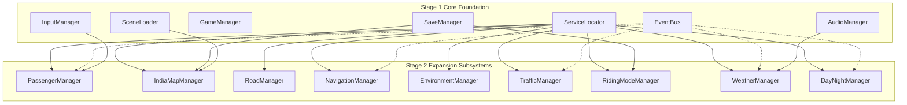

# Stage 2: Passengers, Indian Maps & Environment Systems — Architecture

## 1. System Architecture Overview

**Stage 2 (Parts 15–23)** expands **Indian Bike Life** into a comprehensive 3D open-world motorcycle simulator. All nine new subsystems integrate with the Stage 1 core foundation without altering existing working contracts.



---

## 2. Subsystem Details & Responsibilities

### Part 15: Passenger System (`IndianBikeLife.PassengerSystem`)
- **Manager**: `PassengerManager` implements `IPassengerManager`, `IGameService`, `ISaveable`.
- **Riding Dynamics**: `PassengerAnimationController` handles procedural spine rolling and pitch inertia (leaning into cornering turns up to 20°, leaning back on throttle, leaning forward towards rider on hard braking).
- **Mounting Sequence**: `PassengerMountController` handles standing, approaching motorcycle, mounting interpolation, and seat parenting.
- **Attachment Anchors**: `PassengerSeatPosition` defines spatial attachment points (pelvis seat root, left/right grab rail, rider waist, and foot pegs).
- **Camera Views**: `PassengerCameraController` supports Driver POV, Passenger Over-the-Shoulder, Third-Person Chase, and Cinematic Low-Angle views.
- **Pairing Combinations**: Supports Driver Only, Male+Female, Male+Male, Female+Male, and Female+Female.

### Part 16: Indian Map System (`IndianBikeLife.MapSystem`)
- **Manager**: `IndiaMapManager` implements `IIndiaMapManager`, `IGameService`, `ISaveable`.
- **National Hierarchy**: `India -> State -> District -> City/Town -> Destination -> Start/End Point`.
- **Catalogue**: Data-driven ScriptableObjects for all 28 Indian States and 8 Union Territories.
- **Priority Regions**: Deep structured regional hierarchies for Tamil Nadu, Kerala, Karnataka, Andhra Pradesh, and Telangana.
- **Streaming**: `MapStreamingManager` and `MapChunkLoader` handle distance-based loading and unloading of environmental chunks to conserve mobile RAM.

### Part 17: Real Road System (`IndianBikeLife.RoadSystem`)
- **Manager**: `RoadManager` implements `IRoadManager`, `IGameService`.
- **Splines**: `RoadSpline` evaluates continuous Catmull-Rom curves, tangents, banking roll angles, and lane counts.
- **Procedural Mesh**: `RoadGenerator` extrudes 3D road surfaces with lane markings, curbs, and generates mesh colliders on scene load.
- **Physics Surfaces**: `RoadPhysicsSurface` assigns surface friction properties (Smooth Asphalt 1.0, Worn Tarmac 0.9, Wet Tarmac 0.65, Concrete 0.95, Dirt Track 0.7, Gravel 0.55, Mud Trail 0.45).
- **Traffic Law**: `RoadLaneSystem` implements Left-Hand Traffic (LHT) rules standard throughout India.

### Part 18: Navigation System (`IndianBikeLife.NavigationSystem`)
- **Manager**: `NavigationManager` implements `INavigationManager`, `IGameService`.
- **Route Guidance**: `RouteGenerator` and `RouteManager` track waypoints, calculate distance remaining, estimate travel time, and detect off-route deviations.
- **Checkpoints**: `CheckpointManager` manages trigger volumes and visual road markers.
- **GPS Simulation**: `GPSPositionSimulator` maps Unity world vectors to Indian coordinates (latitude, longitude, heading) without querying real device hardware.
- **HUD**: `NavigationUIController` displays turn-by-turn direction text, distance, and time remaining.

### Part 19: Environment System (`IndianBikeLife.EnvironmentSystem`)
- **Manager**: `EnvironmentManager` implements `IEnvironmentManager`, `IGameService`.
- **Themes**: `VillageRural`, `TownCommercial`, `CityMetropolitan`, `HighwayCorridor`, `HillStationGhat`, `CoastalBeach`.
- **Spawners**: `BuildingSpawner` (houses, dhabas, tea stalls, temples, petrol pumps, bus stops) and `VegetationManager` (banyan, neem, gulmohar, coconut palms, eucalyptus/pine).
- **Optimization**: `LODController` (LOD 0, 1, 2) and `ObjectPoolManager` avoid runtime allocations.

### Part 20: Traffic AI System (`IndianBikeLife.TrafficSystem`)
- **Manager**: `TrafficManager` implements `ITrafficManager`, `IGameService`.
- **Vehicles**: Auto-rickshaws, city buses, heavy trucks, cars, scooters, motorcycles, tractors, delivery vans.
- **Behavior**: `TrafficLaneFollower` (left-lane following), `TrafficCollisionAvoidance` (throttled forward/side raycasting at 10 Hz), and `TrafficLightController` (3-phase signal cycling).
- **Indian Road Nuance**: Horn honking when delayed by stopped obstacles or player motorcycle.
- **Pedestrian AI**: `PedestrianAI` handles sidewalk walking and road crossings.

### Part 21: Riding Modes (`IndianBikeLife.RidingModes`)
- **Manager**: `RidingModeManager` implements `IRidingModeManager`, `IGameService`, `ISaveable`.
- **10 Selectable Experiences**:
  1. Village Ride (Narrow roads, huts, slow traffic)
  2. City Ride (Dense urban intersections, auto-rickshaws, signals)
  3. Highway Ride (National highways, dhabas, heavy trucks)
  4. Hill Station Ghat (Curved mountain roads, hairpin bends, mist)
  5. Long-Distance Trip (Multi-destination tour with checkpoints)
  6. Free Ride (Open unconstrained exploration)
  7. Off-Road Ride (Dirt trails, gravel, rugged terrain)
  8. Night Ride (Midnight highways, headlights, streetlights)
  9. Race Track Ride (Circuit track, lap foundations)
  10. Couple Ride (Romantic scenic ride with passenger integration)

### Part 22: Weather System (`IndianBikeLife.WeatherSystem`)
- **Manager**: `WeatherManager` implements `IWeatherManager`, `IGameService`.
- **Conditions**: Sunny, Cloudy, Overcast, Light Rain, Heavy Rain, Thunderstorm, Fog, Wind, Mist.
- **Controllers**: `RainController` (particle emission & loop audio), `FogController` (exponential fog density & color), `WindController` (Perlin gust forces), `WetRoadController` (modifies tire grip factor down to 0.65).

### Part 23: Day/Night & Seasons (`IndianBikeLife.TimeAndSeasons`)
- **Manager**: `DayNightManager` implements `IDayNightManager`, `IGameService`.
- **Time Clock**: `TimeOfDayController` cycles 00:00 to 24:00 with configurable progression speed.
- **Sun & Moon**: `SunController` rotates directional celestial light, updates golden-hour tints, noon daylight, and blue moonlight.
- **Night Lighting**: `NightLightingManager` toggles streetlights and illuminated props when `IsNight` is true.
- **Seasons**: `SeasonManager` and `SeasonalEnvironmentController` model Summer, Monsoon, and Winter while strictly excluding geographically inaccurate phenomena like snowfall in southern plains.

---

## 3. Data Structures & Event Flow Matrix

```
[Events dispatched on EventBus]
├── PassengerMountedEvent(PassengerData)
├── PassengerDismountedEvent(PassengerData)
├── PassengerSelectedEvent(PassengerData, RidingPairingMode)
├── DestinationSelectedEvent(DestinationData)
├── RouteGeneratedEvent(RouteData)
├── CheckpointReachedEvent(int index)
├── WeatherChangedEvent(WeatherType)
├── TimeOfDayChangedEvent(float hour)
├── SeasonChangedEvent(IndianSeason)
└── TrafficDensityChangedEvent(TrafficDensity)
```

---

## 4. Playable Scene Integration (`RegionalRideTest.unity`)

Scene Build Index: **3** (`SceneIndex.Gameplay = 3`).  
Integrates all Stage 2 components into an interactive regional test environment containing:
- Multi-lane Highway section (NH44 corridor).
- Village / Town roadside stalls and dhaba buildings.
- Elevated curved hill-road section with banking.
- Player motorcycle with passenger seat anchors and mount controller.
- Interactive `RegionalRideTestHUD` allowing live switching of passengers, camera perspectives, weather conditions, time of day, and traffic density.

