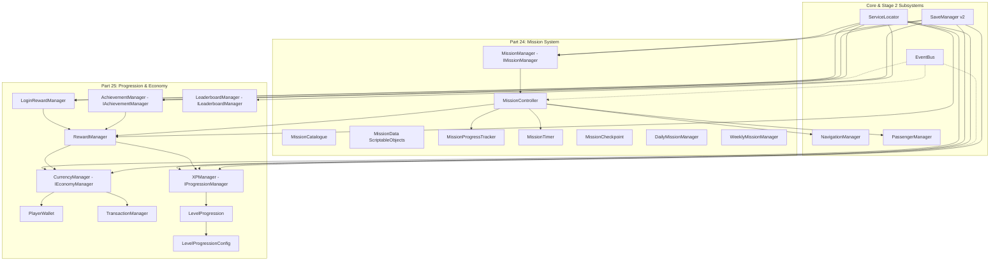

# Stage 3: Missions, Progression & Rewards — Architecture

**Date:** 2026-11-12  
**Project:** Indian Bike Life (Android 3D Motorcycle Simulator)  
**Target Scope:** Stage 3 (Parts 24–25)  
**Author:** Senior Unity Game Architect & Technical Lead  

---

## 1. System Overview

Stage 3 introduces the gameplay loop, progression systems, virtual currencies, and milestone rewards for **Indian Bike Life**. It builds directly on the Stage 1 Core Game Architecture (Service Locator, Event Bus, Save System) and the Stage 2 Open-World & Simulation Subsystems (Navigation, Passengers, Road System, Weather, Riding Modes).

---

## 2. Part 24 — Mission System Architecture

### A. 15 Mission Categories
The mission catalogue supports 15 distinct gameplay styles modeled across Indian roads:
1. **Village Riding (`VillageRiding`):** Narrow rural unpaved tracks, cattle avoidance, rural milk runs.
2. **City Riding (`CityRiding`):** High-density metropolitan junctions, auto-rickshaw traffic, stoplights.
3. **Highway (`Highway`):** 4-lane expressway high-speed endurance cruising (NH44).
4. **Hill Station (`HillStation`):** Steep inclines, 36 hairpin bends of Nilgiris / Western Ghats passes.
5. **Long Distance (`LongDistance`):** Multi-town endurance tours (e.g. Chennai to Pondicherry ECR).
6. **Passenger (`Passenger`):** Pillion balance and safety missions (pillion cannot dismount).
7. **Couple Riding (`CoupleRiding`):** Romantic scenic tours with female companion.
8. **Navigation (`Navigation`):** Waypoint exploration in complex heritage locations (e.g. Hampi).
9. **Exploration (`Exploration`):** Off-the-beaten-path forest trails and viewpoint discovery.
10. **Time Trial (`TimeTrial`):** Tight countdown sprint across coastal bridges or hill routes.
11. **Traffic Challenge (`TrafficChallenge`):** Precision obstacle avoidance through chaotic Indian traffic.
12. **Distance Challenge (`DistanceChallenge`):** Odometer milestones (e.g. Century 100K ride).
13. **Parking Challenge (`ParkingChallenge`):** Low-speed maneuvering into marked bays outside dhabas.
14. **Delivery (`Delivery`):** Time-sensitive perishable snack/milk deliveries.
15. **Special Event (`SpecialEvent`):** Night rides, festival parades (Diwali, Pongal).

### B. Difficulty Scaling (`MissionDifficulty`)
- **Beginner:** $1.35\times$ time limit, $0.4\times$ traffic, $100\%$ allowed damage, $0.8\times$ rewards, $12\text{m}$ checkpoint radius.
- **Easy:** $1.15\times$ time limit, $0.7\times$ traffic, $90\%$ allowed damage, $0.9\times$ rewards, $10\text{m}$ checkpoint radius.
- **Normal:** $1.0\times$ time limit, $1.0\times$ traffic, $75\%$ allowed damage, $1.0\times$ rewards, $8\text{m}$ checkpoint radius.
- **Hard:** $0.85\times$ time limit, $1.3\times$ traffic, $50\%$ allowed damage, $1.4\times$ rewards, $7\text{m}$ checkpoint radius.
- **Expert:** $0.75\times$ time limit, $1.6\times$ traffic, $30\%$ allowed damage, $1.8\times$ rewards, $6\text{m}$ checkpoint radius.
- *Physics Rule:* Difficulty scales challenge parameters, time, and obstacles; it **never** alters the baseline motorcycle physics engine.

### C. Mission Lifecycle & Controller State Machine
- `MissionController` maintains the runtime lifecycle:
  - `StartMission(MissionData, Difficulty)`: Clones asset data, resets timer, initializes checkpoint progress, generates road route via `NavigationManager`.
  - `Update(deltaTime)`: Checks checkpoint proximity, accumulates distance, checks off-route tolerance and passenger requirements.
  - `CompleteMission()`: Computes star rating (1-3 stars), scales payout, invokes `RewardManager`, publishes `MissionCompletedEvent`.
  - `FailMission(reason)`: Stops timer, documents failure reason, publishes `MissionFailedEvent`.
  - `RestartMission()`: Re-initializes checkpoints and timer without leaking memory or state.
  - `CancelMission()`: Cancels navigation route and clears active mission state.

---

## 3. Part 25 — Progression, Economy & Rewards Architecture

### A. Dual Virtual Currency Engine
- **Silver Coins (Soft Currency):** Earned from completing missions, road trips, daily tasks, and distance milestones. Used for standard maintenance, fuel, and gear.
- **Gold Coins (Hard/Prestige Currency):** Earned through weekly challenges, achievements, and 7-day login streaks. Used for exclusive motorcycle models and rare customization items.
- **Ledger Security:**
  - Balances are strictly stored as 32-bit/64-bit integers (`int` / `long`) to eliminate floating-point rounding errors.
  - Balances are clamped to $\ge 0$ (negative balances are strictly rejected).
  - Every transaction is assigned an audit record with UTC timestamp, amount, source/reason, and post-transaction balance.
  - Idempotency checks reject duplicate reward transactions.

### B. Player XP & Level Formula
- Player level progression follows an exponential-plus-linear curve:
  $$\text{XP}_{\text{req}}(L) = \text{round}\left(500 \cdot L^{1.25} + 250 \cdot L\right)$$
- Total cumulative XP to reach level $L$:
  $$\text{TotalXP}(L) = \sum_{k=1}^{L-1} \text{XP}_{\text{req}}(k)$$
- Level milestones unlock motorcycle categories, advanced riding modes (Ghat road, Monsoon), and higher mission tiers.

### C. Anti-Cheat & Streak Management
- `LoginRewardManager` enforces server-authoritative time guidelines:
  - Compares UTC timestamps between successive logins.
  - If current device clock is earlier than last recorded login, clock manipulation is flagged and claim is rejected.
  - Missed calendar days reset the consecutive streak to Day 1, ensuring fair reward distribution.

### D. Leaderboards & Achievements
- `AchievementManager` evaluates milestones across 8 categories: First Ride, Distance (10km, 50km), Missions (10 completed), Hill Stations (Ooty), Passenger (25km), Motorcycle Collection, Riding Time, and State Exploration.
- `LeaderboardManager` caches local rankings (Time Trial, Distance, XP, Weekly Points) and defines the contract for Stage 4 backend network synchronization without creating fake bot accounts.

---

## 4. Save System Schema Version 2 Migration

- Upgrades `SaveData.cs` from **Schema v1** to **Schema v2**.
- Integrates `ProgressionSaveData` container.
- `SaveMigratorV1ToV2` seamlessly converts older saves:
  - Transfers `playerProfile.playerCoins` to `progression.silverCoins`.
  - Retains `playerProfile.playerLevel` and `completedMissionIds`.
  - Re-computes checksum hash across updated fields to protect file integrity.

