# Stage 4: Multiplayer, Social & Backend — Architecture

**Date:** 2026-11-12  
**Project:** Indian Bike Life (Android 3D Motorcycle Simulator)  
**Target Scope:** Stage 4 (Parts 26–29)  
**Author:** Senior Unity Multiplayer Engineer, Network Architect & Technical Lead  

---

## 1. System Overview

Stage 4 introduces networked multiplayer, player social infrastructure, in-game communication, and cloud backend architecture for **Indian Bike Life**. It extends the foundation built in Stage 1 (Core Architecture), Stage 2 (Indian Maps, Passengers, Environment & Riding Modes), and Stage 3 (Missions, Economy & Progression).

```mermaid
graph TD
    subgraph Part 26: Multiplayer System
        MM[MultiplayerManager - IMultiplayerService]
        RM[RoomManager]
        RCM[RoomCodeManager]
        NCH[NetworkConnectionHandler]
        NPC[NetworkPlayerController]
        NBC[NetworkBikeController]
        NPass[NetworkPassengerController]
        MLUI[MultiplayerLobbyUI]
    end

    subgraph Part 27: Social System
        FM[FriendsManager - ISocialService]
        FRC[FriendRequestController]
        SPM[SocialProfileManager]
        CM[ClubManager]
        GRM[GroupRideManager]
    end

    subgraph Part 28: Communication System
        ChatM[ChatManager - IChatService]
        VCM[VoiceChatManager - IVoiceChatService]
        QCC[QuickChatController]
        PMM[PlayerMuteManager]
        PRM[PlayerReportManager]
        CHUD[ChatHUD]
    end

    subgraph Part 29: Backend & Cloud System
        BM[BackendManager - IBackendService]
        AuthM[AuthenticationManager]
        CSM[CloudSaveManager]
        OSM[OfflineSyncManager]
        DBM[DatabaseManager - 16 Collections]
        PDM[PlayerDataManager]
        TSU[TokenSecurityUtility]
        BC[BackendConfiguration]
    end

    SL[ServiceLocator]
    EB[EventBus]
    SM[SaveManager]

    SL --> MM
    SL --> FM
    SL --> ChatM
    SL --> VCM
    SL --> BM

    MM --> RM
    MM --> NCH
    MM --> NPC
    RM --> RCM

    FM --> FRC
    FM --> SPM
    FM --> CM
    FM --> GRM

    ChatM --> QCC
    ChatM --> PMM
    ChatM --> PRM

    BM --> AuthM
    BM --> CSM
    BM --> OSM
    BM --> DBM
    BM --> PDM
```

---

## 2. Part 26: Multiplayer Architecture

### 2.1 Room Model & 4-Player Private Rooms
- **Room Capacity:** Capped at 4 players (`RoomData.MaxRoomPlayers = 4`) to ensure optimal mobile 4G/5G bandwidth efficiency and tight convoy riding dynamics.
- **Room Code Generator:** 6-character uppercase alphanumeric codes (`RoomCodeManager`) excluding ambiguous characters (`0`, `O`, `1`, `I`).
- **Slot Allocation:** Deterministic indexing (0 to 3). Slot 0 is assigned to the room host.
- **Host Migration:** When the room host disconnects or leaves, host privileges automatically transfer to the next chronological player in the room.
- **Password Protection:** Optional private room password hashed with PBKDF2/SHA256 and salted (`IBL_SALT_`).

### 2.2 Network State Synchronization & Interpolation
- **State Snapshot Frequency:** Broadcast at 15–20 Hz (every 50–66 ms).
- **Snapshot Payload (`PlayerNetworkState`):**
  - Sequence number, timestamp, player ID.
  - Position (`Vector3`), rotation (`Quaternion`), velocity (`Vector3`).
  - Forward speed (km/h), steering angle, motorcycle lean roll angle.
  - Engine RPM, gear, brake state.
  - Headlight boolean, horn state.
  - Passenger presence boolean, passenger procedural lean roll angle.
  - Current checkpoint index, vehicle damage percentage.
- **Dead Reckoning & Smoothing:**
  - `NetworkPlayerController` uses linear extrapolation (`_targetPosition + _targetVelocity * (dt * 0.1f)`) and spherical linear interpolation (`Quaternion.Slerp`) at 12 Hz.
- **Anti-Cheat & Anti-Teleportation Validation:**
  - Every incoming snapshot calculates `distanceJump / dt`.
  - If `distanceJump > 30.0f` and implied speed exceeds $48.0\text{ m/s}$ ($>172\text{ km/h}$), the packet is rejected as an anomaly/exploit.

---

## 3. Part 27: Social System Architecture

### 3.1 Social Profiles & Privacy Levels
- `ProfilePrivacyLevel`: `Public`, `FriendsOnly`, `Private`.
- Profile data (level, total distance ridden, motorcycle fleet, club tag) is automatically filtered by `SocialProfileManager.GetSanitizedProfile` based on viewer relationship.

### 3.2 Friend Request Workflow & Blocking
- Managed by `FriendRequestController`.
- Statuses: `Pending`, `Accepted`, `Rejected`.
- Duplicate prevention: cannot send requests to existing friends or pending invitees.
- Blocklist suppression: blocked riders cannot send invites, appear in matchmaking, or chat.

### 3.3 Riding Clubs & Group Rides
- **Club Roles:** `Leader`, `Officer`, `Member`.
- **Riding Club Data:** Name, description, 6-character tag, roster, reputation, shared mileage.
- **Group Ride Coordinator (`GroupRideManager`):** Supports scheduled group cruises (e.g., Western Ghats Monsoon Ride, NH44 Run), meetup coordinates, departure timestamps, and RSVP confirmations.

---

## 4. Part 28: Communication System Architecture

### 4.1 Quick Chat System
- Fast, single-tap communication designed for motorcycle handlebar controls.
- 8 Authentic Indian Riding Phrases:
  1. *"Horn OK Please!"*
  2. *"Take the Ghat Road ahead!"*
  3. *"Fuel stop at the Dhaba!"*
  4. *"Slow down — Speed breaker ahead!"*
  5. *"Wait for pillion!"*
  6. *"Follow my line!"*
  7. *"Nice motorcycle!"*
  8. *"Let's race to the checkpoint!"*

### 4.2 Text Chat Moderation & Rate Limiting
- Client-side regex profanity filter masking abusive terms with asterisks (`***`).
- Spam throttle: maximum 2 messages per second (`MinMessageInterval = 0.5s`).
- Mute functionality (`PlayerMuteManager`) silencing toxic players locally.
- Moderation reporting tickets (`PlayerReportManager`) logged with timestamp and target ID.

### 4.3 Voice Chat Interface
- Defined in `IVoiceChatService` and `VoiceChatManager`.
- Built for Vivox / WebRTC integration with Android microphone permission checks (`UnityEngine.Android.Permission.Microphone`).
- Push-to-Talk (PTT) and voice-activity modes with volume controls and speaking indicators.

---

## 5. Part 29: Backend & Cloud System Architecture

### 5.1 Authentication System
- `AuthenticationManager`:
  - **Guest Mode:** Device-bound ID (`guest_<UUID8>`) with issued HMAC session token.
  - **Email/Password:** Salted SHA256 password hashing with unique user email salt. Plaintext passwords are never stored.
  - **Compliance:** Includes GDPR/Play Store account deletion (`DeleteAccount`) purging personal data.

### 5.2 16 Cloud Firestore / Document Collections
1. `Users`: User identity and auth records.
2. `PlayerProfiles`: Public/social profile information.
3. `PlayerBikes`: Owned motorcycles, livery, and attachments.
4. `BikeUpgrades`: Performance tune levels (engine, suspension, brakes).
5. `Inventory`: Helmets, jackets, riding gloves, horn customizations.
6. `Wallet`: Virtual currencies (INR coins, premium gems).
7. `Transactions`: Audit log of in-game purchases and rewards.
8. `Missions`: Master mission configuration catalogue.
9. `PlayerMissions`: User mission progress and star ratings.
10. `Achievements`: Master achievement catalogue and user unlock status.
11. `Friends`: Social friend pairs and pending invitations.
12. `Clubs`: Motorcycle clubs, rosters, and stats.
13. `Rooms`: Active multiplayer lobbies and ride sessions.
14. `RideHistory`: Completed route telemetry, distance, and top speeds.
15. `MapCatalogue`: National jurisdiction maps, districts, and routes.
16. `DownloadContent`: Regional DLC packages and asset bundles.

### 5.3 Cloud Saves & Conflict Resolution
- Synchronizes `SaveData` between local storage and cloud database.
- Conflict policy: `ClientWinsIfNewer` evaluates ISO 8601 UTC timestamps (`saveTimestampUtc`).
- If server timestamp is newer than local, cloud save upload is rejected with a conflict alert.

### 5.4 Offline Sync & Security
- `OfflineSyncManager`: Buffers up to 50 operations in a FIFO queue when offline; automatically flushes upon reconnect.
- `PlayerDataManager`: Validates critical economy credits using HMAC-SHA256 signatures (`TokenSecurityUtility.ComputeHmac`), rejecting client-side coin tampering.
