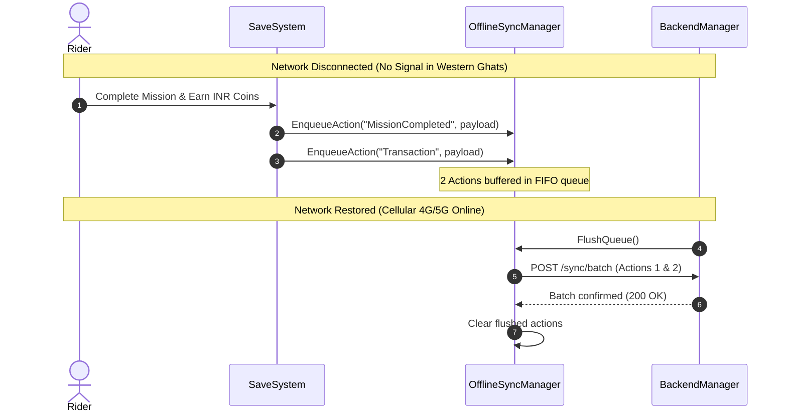

# Backend & Cloud Setup Guide

**Date:** 2026-11-12  
**Project:** Indian Bike Life (Android 3D Motorcycle Simulator)  
**Target Scope:** Part 29 — Backend & Cloud System  

---

## 1. Overview

**Indian Bike Life** utilizes a secure backend architecture supporting Firebase / Cloud Firestore document schemas, REST endpoints, and an offline fallback mode for areas with intermittent mobile network coverage across India.

---

## 2. Configuration (`BackendConfiguration.asset`)

Located at `Assets/Game/Backend/Data/BackendConfiguration.asset`:
- `_environment`: `DevelopmentLocal` (0), `StagingCloud` (1), `ProductionLive` (2).
- `_apiBaseUrl`: Base URL for authentication and telemetry (`https://api.indianbikelife.game/v1`).
- `_requestTimeoutSeconds`: 10.0 seconds default.
- `_enableOfflineMockMode`: Enabled by default (`true`) for local development and offline device simulation.

> [!IMPORTANT]
> The client project NEVER stores Firebase Admin private keys or database root credentials. All writes to sensitive tables (`Wallet`, `Transactions`) must pass through signed server functions.

---

## 3. Database Collections (16 Architecture Domains)

| # | Collection Name | Purpose | Read Rule | Write Rule |
|---|---|---|---|---|
| 1 | `Users` | Authentication & identity records | Owner only | Cloud Function / Auth only |
| 2 | `PlayerProfiles` | Public social profile data | Public / Friends | Document Owner only |
| 3 | `PlayerBikes` | Owned motorcycles and liveries | Owner only | Document Owner only |
| 4 | `BikeUpgrades` | Tuning stages (Engine, Brakes, Suspension) | Owner only | Document Owner only |
| 5 | `Inventory` | Cosmetics (Helmets, Jackets, Horns) | Owner only | Document Owner only |
| 6 | `Wallet` | Coins, Gems, Fuel Tokens | Owner only | **Server HMAC Function only** |
| 7 | `Transactions` | Ledger of all currency credits/debits | Owner only | **Server HMAC Function only** |
| 8 | `Missions` | Master mission catalogue | Public | Admin only |
| 9 | `PlayerMissions` | Star ratings, completion records | Owner only | Document Owner only |
| 10 | `Achievements` | Master achievements catalogue | Public | Admin only |
| 11 | `Friends` | Friend pairs, blocklists, pending invites | Involved users | Document Owner only |
| 12 | `Clubs` | Motorcycle clubs, tags, rosters | Public | Club Officers/Leaders only |
| 13 | `Rooms` | Active 4-player multiplayer sessions | Room participants | Room Host / Cloud Function |
| 14 | `RideHistory` | Telemetry logs and mileage history | Owner only | Document Owner only |
| 15 | `MapCatalogue` | National jurisdiction map metadata | Public | Admin only |
| 16 | `DownloadContent` | Regional DLC asset bundle manifest | Public | Admin only |

---

## 4. Offline Synchronization Flow

