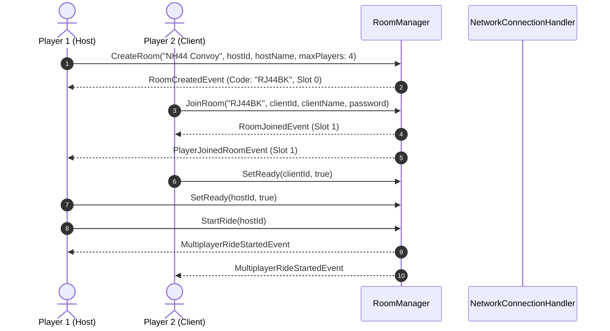

# Multiplayer Setup & Operational Guide

**Date:** 2026-11-12  
**Project:** Indian Bike Life (Android 3D Motorcycle Simulator)  
**Target Scope:** Part 26 — Multiplayer System  

---

## 1. Overview

**Indian Bike Life** features a 4-player private multiplayer room system tailored for mobile network performance on Indian 4G/5G carriers. The architecture supports:
- Dedicated host/client private rooms with 6-character room codes.
- Optional salted password protection.
- 15–20 Hz compact state snapshot synchronization.
- Dead reckoning and client interpolation.
- Anti-speedhack and anti-teleportation validation.

---

## 2. Configuration & Components

### 2.1 Scene Wiring
In `RegionalRideTest.unity`, GameObject `[Stage4_MultiplayerAndBackend]` contains:
- `MultiplayerManager`: Master multiplayer service registering `IMultiplayerService` in `ServiceLocator`.
- `MultiplayerLobbyUI`: OnGUI and runtime UI panel for hosting and joining rooms.

### 2.2 Remote Rider Prefab Hierarchy
When a remote player joins a room, a network player instance is spawned containing:
- `NetworkPlayerController`: Handles translation, rotation, velocity dead reckoning, and anti-cheat validation.
- `NetworkBikeController`: Syncs handlebar steering angle, motorcycle lean roll, headlights, and horn audio.
- `NetworkPassengerController`: Visualizes pillion rider presence, seat alignment, and procedural passenger lean roll.

---

## 3. Host and Join Flow

---

## 4. Mobile Bandwidth Optimization

- **Snapshot Frequency:** 15 Hz default (~66 ms interval).
- **Snapshot Size:** ~60 bytes per snapshot uncompressed, resulting in $<1\text{ KB/s}$ per remote player ($<3\text{ KB/s}$ total download bandwidth for 3 remote peers).
- **Extrapolation:** When network packets are delayed, `NetworkPlayerController` performs velocity-based dead reckoning up to 300 ms, avoiding visual stuttering.

