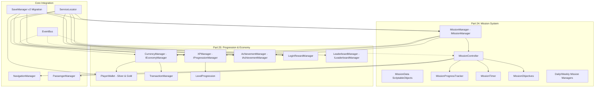

# Stage 3 Pre-Implementation Inspection & Architecture Report

**Date:** 2026-11-12  
**Project:** Indian Bike Life (Android 3D Motorcycle Simulator)  
**Target Scope:** Stage 3 — Missions, Progression & Rewards (Parts 24–25)  
**Author:** Senior Unity Game Architect & Technical Lead  

---

## 1. Executive Summary

Stage 1 (Core Game Architecture) and Stage 2 (Passengers, Indian Maps & Environment Systems) are fully implemented, verified, and committed to Git on branch `main` (`54e6ddc`). 
All 136 C# source files, 301 asset meta files, 4 scenes, and 9 existing subsystem interfaces are functioning cleanly without circular dependencies.

Stage 3 focuses on **Part 24: Mission System** and **Part 25: Coins, XP & Reward System**. This report inspects all existing systems, identifies reusable assets and integration points, assesses missing requirements, and outlines the technical roadmap to build a robust, data-driven, and cheat-resilient mission and economy layer.

---

## 2. Project Inspection & Existing Subsystem Audit

### A. Core Architecture (Stage 1)
- **Service Locator (`ServiceLocator.cs`):** All managers register via `ServiceLocator.Register<TInterface>(service)` on Awake and unregister on OnDestroy. Stage 3 managers (`MissionManager`, `CurrencyManager`, `XPManager`, `AchievementManager`, `LoginRewardManager`) will register as `IGameService` implementations.
- **Event Bus (`EventBus.cs`):** Type-safe decoupled publish-subscribe bus with weak references and unsubscription guards. Stage 3 will introduce `MissionEvents`, `EconomyEvents`, `ProgressionEvents`, and `AchievementEvents`.
- **Save System (`SaveManager.cs`, `ISaveable`, `SaveDataMigrationManager`):**
  - Existing save schema is version 1 (`SaveData.cs`), containing `SettingsSaveData` and `PlayerProfileSaveData`.
  - `PlayerProfileSaveData` already has placeholder fields: `playerLevel`, `playerCoins`, `completedMissionIds`, `unlockedMotorcycleIds`, `totalDistanceDrivenKm`.
  - Stage 3 will upgrade `SaveData` to **Schema Version 2**, implement `SaveMigratorV1ToV2` through `SaveDataMigrationManager`, and introduce dedicated progression containers (`EconomySaveData`, `MissionProgressSaveData`, `AchievementSaveData`, `LoginRewardSaveData`).
  - Integrity verification using `ComputeChecksum()` will be preserved and extended to cover wallet balances.

### B. Environment & Gameplay Systems (Stage 2)
- **Navigation & Checkpoints (`NavigationManager.cs`, `CheckpointManager.cs`, `RouteManager.cs`):**
  - CheckpointManager already handles proximity trigger detection and emits `OnCheckpointPassed(int index)`.
  - RouteManager tracks player distance to waypoints and detects off-route deviations via `OnOffRouteDetected`.
  - Stage 3's `MissionController` and `MissionProgressTracker` will directly interface with `NavigationManager` and `CheckpointManager` without duplicating path calculation.
- **Passenger System (`PassengerManager.cs`, `PassengerSeatPosition.cs`):**
  - `IPassengerManager` exposes `HasPassenger`, `CurrentPassengerData` (name, gender, accessories), and mounting lifecycle events.
  - Stage 3 Passenger Missions (Category 6) and Couple Riding Missions (Category 7) will validate passenger conditions (e.g. required female pillion, specific character, or no passenger dismount).
- **Riding Modes (`RidingModeManager.cs`, `RidingModeData.cs`):**
  - 10 pre-configured riding modes (Village, City, Highway, Ghat, Coastal, Monsoon, Night, Economy, Couple, Free Roam) already specify speed limits, weather presets, and traffic density.
  - Missions will reference riding modes or enforce mode parameters during mission execution.
- **Weather & Day/Night (`WeatherManager.cs`, `DayNightManager.cs`):**
  - Weather can be overridden for specific mission requirements (e.g. Monsoon delivery or Night time trial).
  - Time of day can be configured per mission profile.

---

## 3. Reusable Components Matrix

| Existing Subsystem | Component / Class | Stage 3 Reuse Pathway |
|---|---|---|
| **Navigation** | `CheckpointManager` | Reuse for checkpoint detection and arrival triggers in checkpoint/route missions. |
| **Navigation** | `RouteManager` | Reuse for distance calculation, ETA, and off-route failure detection. |
| **Passenger** | `PassengerManager` | Query passenger state, gender, and mount status for passenger/couple missions. |
| **Persistence** | `SaveManager` & `ISaveable` | Implement `ISaveable` across `PlayerWallet`, `MissionManager`, `XPManager`, `AchievementManager`. |
| **Save Migrations** | `SaveDataMigrationManager` | Register `SaveMigratorV1ToV2` to upgrade older v1 saves seamlessly. |
| **Event Bus** | `EventBus` | Decoupled notifications when objectives update, levels increase, coins change, or achievements unlock. |
| **Audio** | `AudioManager` | Trigger sound cues for coin earning, mission victory, mission failure, and level up. |
| **Scene Testing** | `RegionalRideTest.unity` | Extend test scene with Mission and Economy HUD controls. |

---

## 4. Identified Missing Requirements for Stage 3

1. **Mission Data Structures:**
   - 15 mission categories with distinct objective models (Time Trial, Checkpoint Race, Passenger Delivery, Fuel Economy, Speed Trap, Exploration).
   - Configurable failure conditions (timer expiration, route boundary departure, bike health/crash limit, passenger dismount).
2. **Virtual Currency Engine:**
   - Two currencies: Silver Coins (soft currency) and Gold Coins (hard/prestige currency).
   - Strict transaction ledger with idempotency keys to prevent duplicate rewards and negative balances.
3. **Player Progression Engine:**
   - Non-linear XP formula: $XP(L) = 500 \cdot L^{1.3} + 250 \cdot L$.
   - Milestone rewards and unlock gates for bikes, modes, and cosmetic items.
4. **Daily / Weekly Timers & Anti-Cheat:**
   - Local system clock manipulation protection (monotonic uptime delta + server-timestamp fallback contract).
   - 7-day recurring login reward calendar with streak protection.
5. **Achievement & Local Leaderboard Framework:**
   - Data-driven achievement registry tracking 8 distinct categories.
   - Leaderboard data model supporting offline high scores while strictly abstracting Stage 4 backend network sync (no fake bot rankings).

---

## 5. Technical Implementation Roadmap

---

## 6. Proposed Script & Asset Manifest

### Interfaces (`Assets/Game/Interfaces/`):
- `IMissionManager.cs`
- `IEconomyManager.cs`
- `IProgressionManager.cs`
- `IAchievementManager.cs`
- `ILeaderboardManager.cs`

### Mission System (`Assets/Game/MissionSystem/`):
- `Data/MissionCategory.cs` (15 categories)
- `Data/MissionDifficulty.cs` (Beginner to Expert)
- `Data/MissionObjective.cs` (Data model for variable objectives)
- `Data/MissionData.cs` (ScriptableObject definition)
- `Data/MissionCatalogue.cs` (Aggregated catalogue)
- `Scripts/MissionTimer.cs`
- `Scripts/MissionCheckpoint.cs`
- `Scripts/MissionProgressTracker.cs`
- `Scripts/MissionController.cs`
- `Scripts/DailyMissionManager.cs`
- `Scripts/WeeklyMissionManager.cs`
- `Scripts/MissionResultController.cs`
- `Scripts/MissionManager.cs`
- `UI/MissionHUD.cs` & `UI/MissionCatalogueUI.cs`

### Progression & Economy (`Assets/Game/Progression/`):
- `Economy/CurrencyType.cs` (Silver, Gold)
- `Economy/TransactionRecord.cs`
- `Economy/PlayerWallet.cs`
- `Economy/TransactionManager.cs`
- `Economy/CurrencyManager.cs`
- `XP/LevelProgressionConfig.cs`
- `XP/LevelProgression.cs`
- `XP/XPManager.cs`
- `Rewards/RewardType.cs`
- `Rewards/RewardData.cs`
- `Rewards/RewardManager.cs`
- `Rewards/LoginRewardManager.cs`
- `Achievements/AchievementData.cs`
- `Achievements/AchievementCatalogue.cs`
- `Achievements/AchievementManager.cs`
- `Leaderboards/LeaderboardEntry.cs`
- `Leaderboards/LeaderboardType.cs`
- `Leaderboards/LeaderboardManager.cs`

### Save System Migration (`Assets/Game/SaveSystem/`):
- `Data/ProgressionSaveData.cs`
- Update `SaveData.cs` (Schema v2)
- `Migrations/SaveMigratorV1ToV2.cs`

---

## 7. Inspection Approval

This audit confirms that all Stage 1 and Stage 2 subsystems are fully compatible with Stage 3 requirements. The proposed architecture introduces zero destructive changes to existing files, builds directly on established patterns, and adheres to Android performance and memory constraints. Implementation may proceed immediately.

