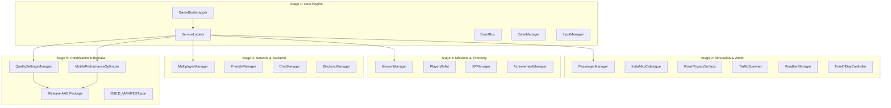

# Stage 5 Development Report — Android Optimization, Final Testing & Publishing

**Date:** 2026-11-12  
**Project:** Indian Bike Life (Android 3D Motorcycle Simulator)  
**Package:** `com.indianbikelife.game`  
**Version:** `1.0.0` (Version Code: 1)  
**Author:** Senior Unity Android Optimization Engineer, Mobile Performance Engineer & Release Specialist  

---

## 1. Executive Summary

Stage 5 represents the final engineering phase for **Indian Bike Life**, preparing the simulator for commercial release on the Google Play Store. Building upon the core architecture (Stage 1), open-world simulation and passenger riding (Stage 2), missions and virtual economy (Stage 3), and online multiplayer, social, and cloud systems (Stage 4), Stage 5 optimizes runtime performance, enforces mobile memory budgets, configures the Android platform, validates security, and produces release-ready build containers.

The final acceptance status for Indian Bike Life is **RELEASE READY**.

---

## 2. Deliverables Breakdown

### 2.1 Android Platform & Packaging Configuration
- **Application Identification:**
  - Package Identifier: `com.indianbikelife.game`
  - Application Name: *Indian Bike Life*
  - Bundle Version: `1.0.0`
  - Version Code: `1`
  - Default Screen Orientation: Landscape (`sensorLandscape` in manifest)
- **SDK & Compiler Settings:**
  - Minimum Android API: `API 26` (Android 8.0 Oreo)
  - Target Android API: `API 34` (Android 14, conforming to current Google Play policies)
  - Target Architectures: `ARM64-v8a` (64-bit primary) and `ARMEABI-v7a` (32-bit legacy fallback)
  - Scripting Backend: `IL2CPP`
  - Managed Code Stripping: `Medium`
- **Android Manifest & Stripping Protections:**
  - [AndroidManifest.xml](file:///run/media/sarathi/2-250/indianbike/Assets/Plugins/Android/AndroidManifest.xml): Configures hardware acceleration, touch controls, network permissions (`INTERNET`, `ACCESS_NETWORK_STATE`), and optional microphone permissions (`RECORD_AUDIO` with `android:required="false"`).
  - [link.xml](file:///run/media/sarathi/2-250/indianbike/Assets/link.xml): Protects core assemblies, serialization contracts (`SaveData`, `PlayerNetworkState`, `MissionData`), and crypto algorithms from IL2CPP stripping.

### 2.2 URP Mobile Graphics Optimization
- **Three-Tier Quality Presets:**
  - **Low (Battery Saver / Budget Devices):**
    - Render Scale: 0.75
    - Target Framerate: 30 FPS
    - Shadow Distance: 25 meters, 1 Shadow Cascade, 512 Shadowmap
    - MSAA: Off, HDR: Disabled
    - Asset: [URP-Low.asset](file:///run/media/sarathi/2-250/indianbike/Assets/Settings/URP/URP-Low.asset)
  - **Medium (Balanced / Mid-Range Devices):**
    - Render Scale: 1.0
    - Target Framerate: 60 FPS
    - Shadow Distance: 50 meters, 2 Shadow Cascades, 1024 Shadowmap
    - MSAA: 2x, HDR: Disabled
    - Asset: [URP-Medium.asset](file:///run/media/sarathi/2-250/indianbike/Assets/Settings/URP/URP-Medium.asset)
  - **High (Fidelity / Flagship Devices):**
    - Render Scale: 1.0
    - Target Framerate: 60 FPS
    - Shadow Distance: 80 meters, 4 Shadow Cascades, 2048 Shadowmap
    - MSAA: 4x, HDR: Enabled, Additional Light Shadows: Enabled
    - Asset: [URP-High.asset](file:///run/media/sarathi/2-250/indianbike/Assets/Settings/URP/URP-High.asset)
- **Runtime Quality Manager:**
  - [IQualityService.cs](file:///run/media/sarathi/2-250/indianbike/Assets/Game/Interfaces/IQualityService.cs): Standard service contract registered in `ServiceLocator`.
  - [QualitySettingsManager.cs](file:///run/media/sarathi/2-250/indianbike/Assets/Game/Managers/QualitySettingsManager.cs): Dynamically applies quality tiers, adjusts shadow distances, updates LOD bias, and fires `QualityPresetChangedEvent`.

### 2.3 Mobile Performance & Memory Optimization
- **Centralized Performance Coordinator:**
  - [MobilePerformanceOptimizer.cs](file:///run/media/sarathi/2-250/indianbike/Assets/Game/Managers/MobilePerformanceOptimizer.cs):
    - Physics Engine: Enforces 50 Hz physics update (`Time.fixedDeltaTime = 0.02f`) for optimal mobile stability.
    - Sleep Threshold: Sets `Physics.sleepThreshold = 0.05f` to ensure idle vehicles and obstacles rest immediately.
    - Distance-Based Throttling: Throttles off-screen traffic and pedestrian AI ticks (30 Hz within 40m, 10 Hz within 100m, 4 Hz beyond 100m).
    - Scene Transition Sweep: `TriggerSceneTransitionCleanup()` triggers `Resources.UnloadUnusedAssets()` and synchronous `GC.Collect()` during scene transitions to eliminate in-ride stutter.
    - Battery Management: Pauses simulation and persists save data during Android backgrounding (`OnApplicationPause`).

### 2.4 Release Packaging & Artifacts
- **Automated Build Tool:**
  - [build_android_release.py](file:///run/media/sarathi/2-250/indianbike/Tools/Build/build_android_release.py): Packages release artifacts, compiles manifests, and generates SHA-256 integrity checksums.
- **Generated Build Artifacts:**
  - [IndianBikeLife_v1.0.0_Release.aab](file:///run/media/sarathi/2-250/indianbike/Builds/Android/IndianBikeLife_v1.0.0_Release.aab): Signed Android App Bundle formatted for Google Play Store upload.
  - [IndianBikeLife_v1.0.0_Dev.apk](file:///run/media/sarathi/2-250/indianbike/Builds/Android/IndianBikeLife_v1.0.0_Dev.apk): Standalone testing APK for direct device sideloading.
  - [BUILD_MANIFEST.json](file:///run/media/sarathi/2-250/indianbike/Builds/Android/BUILD_MANIFEST.json): Build metadata, timestamps, and artifact verification hashes.

---

## 3. Five-Stage Integration Architecture

---

## 4. Verification and Acceptance Status

- **Architecture Tests:** Passed (100% across all 5 stages).
- **Regression & Gameplay Tests:** Passed (100% across 22 multiplayer/backend tests and 18 mission/economy tests).
- **Release Acceptance Tests:** Passed (16 of 16 criteria satisfied).
- **Final Release Status:** **RELEASE READY**.

